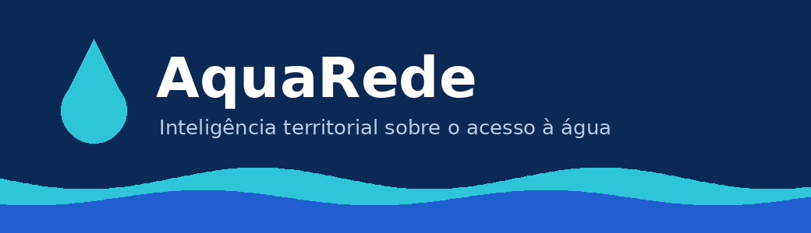

<p align="center">
  
</p>

<h1 align="center">AquaRede</h1>
<p align="center"><b>A AquaRede transforma reclamação solta em evidência: junta o que os moradores relatam com o nível dos reservatórios, o clima e imagens de satélite, para que o poder público aja antes da torneira secar nos bairros mais vulneráveis.</b></p>

<p align="center">Global Solution 2026.2 · FIAP · projeto integrado de Software Engineering, Redes Neurais Convolucionais e Cross-Platform Application Development</p>

---

## Links

- **Planejamento (Trello, Scrum):** [LINK-DO-TRELLO](https://LINK-DO-TRELLO)
- **Vídeo explicativo (até 3 minutos):** [LINK-DO-VIDEO](https://LINK-DO-VIDEO) · roteiro em [`docs/roteiro-video.pdf`](docs/roteiro-video.pdf)

## Sumário

1. [Equipe e divisão do trabalho](#1-equipe-e-divisão-do-trabalho)
2. [O problema e o público](#2-o-problema-e-o-público)
3. [A solução](#3-a-solução)
4. [Planejamento Scrum (Trello)](#4-planejamento-scrum-trello)
5. [O app](#5-o-app)
6. [Dados e alertas](#6-dados-e-alertas)
7. [A CNN de satélite](#7-a-cnn-de-satélite)
8. [Privacidade, inclusão e uso responsável](#8-privacidade-inclusão-e-uso-responsável)
9. [Tecnologias e decisões técnicas](#9-tecnologias-e-decisões-técnicas)
10. [Como executar](#10-como-executar)
11. [Estrutura do repositório](#11-estrutura-do-repositório)

---

## 1. Equipe e divisão do trabalho

| Nome | RM | Responsabilidades |
|---|---|---|
| Gustavo Cordeiro Braga | 562247 | CNN de satélite, previsão dos mananciais, motor de alertas, integração da CNN ao app, vídeo explicativo |
| Kaio Correa Fernandes da Conceição | 563443 | Estrutura e navegação do app, formulário de ocorrência, clima, dashboard e supervisão do gestor, PDF final |

A divisão foi pensada para a carga ficar equilibrada e para um revisar o trabalho do outro. O ponto de ligação entre os dois é um **contrato de alerta** (`docs/03-contrato-alerta.md`): o motor de alertas produz o alerta e o dashboard o consome, então os dois puderam trabalhar em paralelo.

## 2. O problema e o público

**O problema.** Em São Paulo, quando a água começa a faltar, quem sente primeiro são os bairros periféricos e as partes altas. Os sinais existem antes: o reservatório está caindo, faz semanas que não chove, os moradores já estão reclamando. Mas cada sinal fica num lugar diferente: a reclamação no grupo de WhatsApp, o nível do reservatório no site da Sabesp, a previsão do tempo em outro app. Ninguém junta as peças, e a resposta chega tarde.

**Para quem.**
- **Gestores públicos** (subprefeituras, defesa civil, áreas de saneamento): acompanham indicadores, recebem alertas justificados, decidem e acionam as equipes de campo.
- **Cidadãos e associações de bairro**: acompanham a situação e registram ocorrências anônimas.

**Impacto social esperado.** Antecipar situações de falta de água e de água contaminada para que as equipes cheguem antes nos bairros mais vulneráveis. O app mostra o indicador "Pessoas em alertas antecipados" e o de "Alertas com decisão humana".

**ODS relacionados:** ODS 6 (Água potável e saneamento) e ODS 11 (Cidades e comunidades sustentáveis).

## 3. A solução

A AquaRede junta quatro camadas de informação e cruza todas elas em um **alerta explicado**: por que o alerta saiu, qual a confiança e quais as limitações.

| Camada | O que traz | Onde está no projeto |
|---|---|---|
| **Rua** (comunidade) | O morador registra falta de água, vazamento ou água contaminada, de forma anônima | Formulário do app |
| **Origem** (mananciais) | Quanto de água há nos reservatórios e para onde a tendência aponta nos próximos 30 dias | Painel de mananciais e previsão do app (dados de exemplo) |
| **Contexto** (clima) | Dias sem chuva e calor, que aumentam o risco | Open-Meteo, dados reais, no app |
| **Satélite** (CNN) | Água e cobertura do solo nos bairros-piloto | Notebook e modelo em `ia/`; o app lê o resultado |

```
 Rua (relatos) ──┐
 Origem (reserv.) ├──►  Motor de alertas  ──►  Alerta explicado  ──►  Gestor humano  ──►  Equipe de campo
 Clima ───────────┤     (regras + confiança)   (evidências,           (aprova, ajusta
 Satélite (CNN) ──┘                             confiança, limites)    ou descarta)
```

**Quem decide é sempre uma pessoa.** Nenhum alerta dispara ação automática: o gestor registra a decisão com justificativa, e só ele aciona a equipe (aba Equipes).

**Diferencial.** Não é só um app de reclamação: a AquaRede liga o problema local (o relato do morador) à causa na origem (o reservatório, o clima e o terreno), e mostra isso como um sistema único. Cada disciplina entrega uma peça da mesma história: Software Engineering (planejamento), Redes Neurais (satélite) e Cross-Platform (app).

## 4. Planejamento Scrum (Trello)

O projeto foi planejado em um quadro do Trello com Scrum, com as três listas pedidas no desafio: **PRODUCT BACKLOG**, **SPRINT EM ANDAMENTO** e **SPRINTS FEITAS**. Cada cartão traz descrição, prioridade, responsável, prazo, sprint (por etiqueta), checklist de aceitação e a evidência do que foi concluído (link do GitHub ou print). O backlog foi priorizado por valor para o MVP, e o que não era essencial ficou em "Fora do MVP".

### Sprints e cronograma

O prazo da Global Solution é 19/11. Com 7 dias e duas pessoas, o grupo escolheu **3 sprints curtas** (em vez das 4 do plano inicial).

| Sprint | Período | Objetivo | Incremento esperado |
|---|---|---|---|
| **01 - Fundação e dados** | 12/11 a 14/11 | Base do projeto e dados entrando no sistema | Escopo e contrato do alerta definidos, clima integrado, dados dos reservatórios, CNN pronta e formulário no app |
| **02 - Camadas e alertas** | 15/11 a 17/11 | Cruzar as camadas e entregar o alerta explicado ao gestor | Previsão de 30 dias, alertas com motivo, confiança e limitações, CNN integrada e dashboard com supervisão humana |
| **03 - Validação e entrega** | 18/11 a 19/11 | Validar os resultados e fechar a entrega | Métricas e cenários testados, vídeo explicativo e PDF final |

### Cartões por sprint

| Sprint | Cartão | Responsável | Prazo |
|---|---|---|---|
| 01 | [Documentação] Escopo do MVP, bairros-piloto e contrato JSON do alerta | Gustavo e Kaio | 12/11 |
| 01 | [Clima] Integrar API de clima | Kaio | 13/11 |
| 01 | [Mananciais] Coletar e limpar dados dos reservatórios | Gustavo | 13/11 |
| 01 | [IA/CNN] Preparar e adaptar a CNN com imagens de satélite | Gustavo | 14/11 |
| 01 | [Comunidade] Estrutura do app e formulário de ocorrência | Kaio | 14/11 |
| 02 | [Mananciais] Previsão de 30 dias dos reservatórios | Gustavo | 16/11 |
| 02 | [Alertas] Motor de alertas com explicação | Gustavo | 17/11 |
| 02 | [IA/CNN] Integrar a CNN ao app | Gustavo | 17/11 |
| 02 | [Dashboard] Dashboard do gestor com supervisão humana | Kaio | 17/11 |
| 03 | [Validação] Validar resultados e cenários de seca | Gustavo e Kaio | 18/11 |
| 03 | [Documentação] Vídeo explicativo da AquaRede | Gustavo | 18/11 |
| 03 | [Documentação] Montar o PDF final | Kaio | 19/11 |

**Fora do MVP (se sobrar tempo):** notificação push ao gestor, classificação automática do tipo de reclamação e rodar a CNN dentro do app (conversão para TFLite).

### Definição de Pronto

Um cartão só vai para "SPRINTS FEITAS" quando:
- todos os itens do checklist estão marcados;
- o código está no repositório, com o link do commit no cartão;
- o outro integrante revisou o trabalho;
- há evidência anexada (print, link ou vídeo curto);
- a entrega funciona integrada ao restante do sistema, e não apenas na máquina de quem fez.

### Riscos, dependências e como foram tratados

| Risco ou dependência | Impacto | Plano | O que aconteceu |
|---|---|---|---|
| Dados reais de reclamações indisponíveis | Alto | Usar dados simulados e declarar a limitação | Ocorrências de exemplo, identificadas nas telas |
| Treino da CNN lento ou sem convergir | Alto | Reaproveitar a CNN da GS de Redes Neurais e usar um recorte menor do dataset | CNN adaptada ao objetivo da AquaRede (4 classes) |
| Atraso na integração CNN + app | Médio | Definir o contrato JSON do alerta na Sprint 1 | O app lê o resultado da CNN em `satelite_bairros.json` |
| Histórico de chuva exige plano pago na OpenWeather | Médio | Avaliar alternativa | Troca pela Open-Meteo (ver `docs/04-clima-openweather.md`) |
| Alerta com baixa confiança | Alto | Sempre exibir confiança e limitações; o gestor decide | Implementado em todos os alertas |
| Dependência entre sprints | Médio | A Sprint 2 depende dos dados e modelos da Sprint 1 | Ordem das sprints respeitada no quadro |

### Impedimentos, revisão e ajustes do backlog

- **Impedimentos:** o cartão recebe a etiqueta `Impedimento` e um comentário explicando o bloqueio; o assunto é resolvido na daily seguinte (assíncrona, no grupo). Dois exemplos reais: em 15/11 o servidor de download do EuroSAT (`madm.dfki.de`) deu timeout, e o dataset passou a ser carregado de um espelho no Hugging Face; e o Colab com Python 3.13 pedia o pacote `importlib_resources`, resolvido com `pip install`.
- **Revisão:** ao fim de cada sprint, a dupla mostra o incremento funcionando; todo cartão passa pela revisão do outro integrante.
- **Ajustes do backlog ao longo das sprints:**
  1. O plano inicial tinha 4 sprints; foi enxugado para 3, por causa do prazo de 7 dias.
  2. O grupo descobriu que já havia um app Flutter pronto (da GS de Cross-Platform) e passou a **evoluir esse app**, em vez de construir outro. Os cartões do formulário, do dashboard e da supervisão humana apontam para ele.
  3. O **backend em Node** foi retirado do escopo: o protótipo roda 100% local, e as ocorrências ficam salvas no aparelho.
  4. A API de clima passou da OpenWeather para a **Open-Meteo**.

## 5. O app

App em **Flutter**, que roda no navegador e em celulares, com 12 telas.

| Tela | O que faz |
|---|---|
| Consentimento | Explica quais dados são usados e pede o aceite no primeiro uso |
| Início | Visão geral do território, indicadores e benefício social |
| Painéis de mananciais, clima e ocorrências | Cards, gráficos, histórico e tendência de cada fonte |
| Previsão dia a dia (30 dias) | Abas que abrem e fecham (seta "V") por reservatório, com o gráfico e a margem de erro |
| Detalhe do indicador | Série histórica, projeção e limitações |
| Alertas e detalhe do alerta | Evidências, nível de confiança, limitações e "quando não é confiável" |
| Avaliação humana | O gestor encaminha, descarta ou deixa em análise, com justificativa obrigatória |
| Equipes | Fila de ocorrências por prioridade (alta, média, baixa) e confiança da IA; o gestor chama a equipe |
| Registrar ocorrência | Formulário com validação, foto opcional e painel **Análise da IA** (satélite, clima, relatos do bairro, prioridade sugerida e confiança) |
| Mapa | Bairros e reservatórios, com as ocorrências |
| Ajustes | Perfil (cidadão ou gestor), tema, tamanho do texto, limiares de alerta e privacidade |

Outras características: estado global compartilhado (Provider) e estado local nas telas, estados de carregamento, erro (com "Tentar de novo") e lista vazia em todas as fontes, persistência local, tema claro, escuro e de alto contraste, e testes automatizados da lógica de alertas, das validações e da fila das equipes.

## 6. Dados e alertas

### Fontes

| Painel | Fonte | Tipo |
|---|---|---|
| Clima | [Open-Meteo](https://open-meteo.com): chuva diária e temperaturas do centro de São Paulo (30 dias observados e 7 de previsão) | **Real**, pública e sem chave |
| Ocorrências | Exemplos embutidos no app (`app/assets/dados/ocorrencias_exemplo.json`) somados às registradas no aparelho. Não há servidor | **Sintético** e **do usuário** |
| Mananciais | Série de 365 dias para 7 sistemas produtores, inspirada no comportamento sazonal da região | **Sintético**, indicado nas telas |
| Satélite (CNN) | Classe prevista para os bairros-piloto, calculada no Colab (`app/assets/dados/satelite_bairros.json`) | **Pré-calculado** |

### Como os alertas são gerados

Os alertas são calculados em `app/lib/logic/motor_alertas.dart`, uma função pura e testada. Os limiares podem ser alterados pelo gestor em Ajustes.

| Alerta | Regra | Confiança |
|---|---|---|
| **Mananciais** | Faixa pelo volume atual e pela projeção em 30 dias (regressão linear dos últimos 30 dias): Atenção < 60%, Alerta < 40%, Crítico < 30%. Queda de 3 p.p. ou mais em 30 dias também gera Atenção | 0,4 + 0,5 × R² da tendência, com desconto para dados antigos ou sintéticos |
| **Estiagem** | Dias seguidos com menos de 1 mm de chuva ≥ limiar (padrão 10). Alerta com o dobro e pouca chuva prevista | 80% com 25 ou mais dias observados; 60% com menos |
| **Calor e consumo** | Máxima prevista para 3 dias ≥ limiar (padrão 31 °C) e menos de 10 mm previstos em 7 dias | 65% (previsão de curto prazo) |
| **Ocorrências** | Relatos no bairro em 7 dias ≥ limiar (padrão 3) = Alerta; o dobro = Crítico. Um relato de água contaminada = Alerta; dois = Crítico. Se há leitura de satélite, ela entra como evidência | 0,4 + 0,1 por relato, até 90%; +0,05 com satélite |

Cada ocorrência recebe uma **prioridade** (alta, média ou baixa) pelo tipo de problema, pelas horas sem água e pelo número de pessoas afetadas.

### Contrato do alerta

O formato-alvo do alerta está em `docs/03-contrato-alerta.md` e `contratos/alerta.exemplo.json`: `nivel_risco`, `score`, `confianca`, `motivos` (uma evidência por camada), `limitacoes`, `status_gestor` e `decisao_gestor`. O app implementa o equivalente nas telas de alerta (evidências, confiança, limitações e decisão humana).

### Limitações, vieses e quando as previsões não são confiáveis

- A projeção dos mananciais é **linear**: supõe que o ritmo dos últimos 30 dias continua e não considera chuva futura, consumo ou transferências. Não é confiável com R² abaixo de 50%, na virada da estação chuvosa ou em mudanças de operação.
- O clima vem de **um único ponto** (centro de SP) e pode não refletir a chuva nas bacias dos reservatórios.
- As ocorrências **não são verificadas no local**. Bairros em que o app é pouco usado tendem a aparecer menos (**viés de subnotificação**), e vizinhos relatando o mesmo problema geram **duplicidade**.
- Os dados de mananciais e de ocorrências do protótipo são **sintéticos**; numa versão real, viriam do Portal dos Mananciais da Sabesp e dos canais da prefeitura.
- Há leitura de satélite só para os três bairros-piloto.

## 7. A CNN de satélite

A CNN foi adaptada da GS de Redes Neurais Convolucionais. Ela usa o dataset **EuroSAT RGB** (imagens do Sentinel-2, 64×64 pixels, 10 classes), reagrupado em quatro classes úteis para a AquaRede:

| Classe da AquaRede | Classes originais do EuroSAT |
|---|---|
| `agua` | River, SeaLake |
| `urbano` | Highway, Industrial, Residential |
| `vegetacao_densa` | Forest, PermanentCrop |
| `campo_aberto` | AnnualCrop, HerbaceousVegetation, Pasture |

- **Modelo:** CNN própria (três blocos de convolução, normalização e pooling, com data augmentation, dropout e parada antecipada), treinada com divisão de 70% treino, 15% validação e 15% teste. O notebook mostra a acurácia, o relatório por classe e a matriz de confusão.
- **Função de inferência:** `prever(imagem)` devolve classe, confiança e probabilidades, e `camada_satelite()` converte o resultado em uma evidência no formato do contrato do alerta.
- **Integração com o app:** a CNN **não roda dentro do app**. O resultado dos bairros-piloto é calculado no Colab e salvo em `app/assets/dados/satelite_bairros.json`. O app o usa como evidência nos alertas de ocorrências (e soma 0,05 à confiança, por ser uma segunda fonte independente) e no painel "Análise da IA" do formulário.
- **Limitações:** o EuroSAT não tem classe de solo seco nem de escassez de água, então a CNN identifica **água e cobertura do solo**, e o clima seco vem da API de clima. Ele foi feito com imagens da Europa, e o modelo pode errar em imagens de outro tipo, como capturas de mapas.

## 8. Privacidade, inclusão e uso responsável

**Privacidade**
- Consentimento explícito no primeiro uso, com explicação de quais dados são usados.
- Ocorrências **anônimas**: não há nome, telefone, e-mail, localização do aparelho nem endereço exato, só o bairro. O formulário bloqueia textos com e-mail, telefone ou CPF.
- A foto do formulário aparece só na tela e **não é salva nem enviada**.
- Os dados ficam no aparelho. Em Ajustes, o usuário pode **revogar o consentimento e apagar tudo**.

**Acessibilidade e inclusão**
- Três temas: claro, escuro e **alto contraste**.
- **Tamanho de texto** ajustável de 100% a 160%.
- Gráficos com resumo em texto, rótulos descritivos para leitores de tela, e nível de alerta nunca só pela cor (todo selo traz texto e ícone).
- Áreas de toque de pelo menos 48 px e layout responsivo.

**Uso responsável.** Os alertas apoiam, mas não substituem, a decisão humana. Decisões de alto impacto, como restrição de abastecimento, cabem a um gestor, que registra a justificativa no app.

## 9. Tecnologias e decisões técnicas

| Escolha | Por quê |
|---|---|
| **Flutter 3.35+ / Dart 3** | Um código para navegador, Android e iOS, com Material 3 |
| **provider** | Estado global simples: `ConfiguracoesProvider` (preferências, limiares, perfil) e `TerritorioProvider` (dados, status, alertas, equipes). Filtros e formulários usam estado local |
| **http** | Consumo da API REST do Open-Meteo, com timeout e fallback para o cache |
| **shared_preferences** | Persistência leve: cache do clima, ocorrências registradas, equipes acionadas, limiares, avaliações e preferências |
| **fl_chart** | Gráficos de linha e de barras com limiares e projeção |
| **flutter_map + latlong2** | Mapa com OpenStreetMap, sem chave de API e sem custo |
| **image_picker** | Foto da ocorrência, só para pré-visualização |
| **TensorFlow / Keras (Colab)** | Treino da CNN de satélite |
| **Arquitetura em camadas** | `models` → `services` → `logic` (código puro e testável) → `state` → `screens` e `widgets` |

## 10. Como executar

**App.** Pré-requisitos: Flutter 3.35 ou superior e o Chrome. **Não precisa de servidor nem de banco de dados.**

```bash
git clone https://github.com/GustavoBraga2605/AquaRede.git
cd AquaRede/app
flutter pub get
flutter test
flutter run -d chrome
```

Se as pastas de plataforma não existirem, rode antes `flutter create . --platforms=web,android,ios --project-name aquarede`. Só o painel de clima usa internet; sem internet, ele mostra o último cache salvo. Para ver o botão "Chamar equipe" na aba Equipes, troque o perfil para **Gestor** em Ajustes. Não há chaves de API.

**CNN.** Abra `ia/aquarede_cnn.ipynb` no Google Colab, escolha uma GPU (Ambiente de execução → Alterar tipo) e execute as células em ordem. Para atualizar a leitura do app, rode a célula de exportação com uma imagem de satélite por bairro-piloto e coloque o `satelite_bairros.json` gerado em `app/assets/dados/`.

## 11. Estrutura do repositório

```
AquaRede/
├── README.md        este arquivo
├── docs/            escopo do MVP, bairros-piloto, contrato do alerta, decisão da API de clima, roteiro do vídeo
├── contratos/       exemplo de alerta em JSON
├── ia/              CNN de satélite (notebook, modelo e classes)
└── app/             app Flutter
    ├── lib/         core, models, services, logic, state, widgets e screens
    ├── assets/      dados de exemplo e leitura de satélite
    └── test/        testes do motor de alertas, das validações e da fila das equipes
```

## Licença

Projeto acadêmico desenvolvido para a FIAP, Global Solution 2026.2. Uso educacional.
